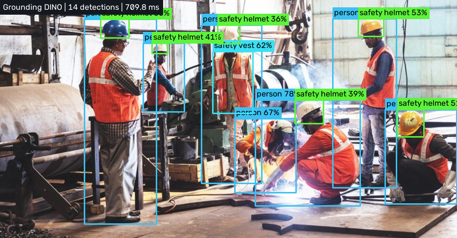
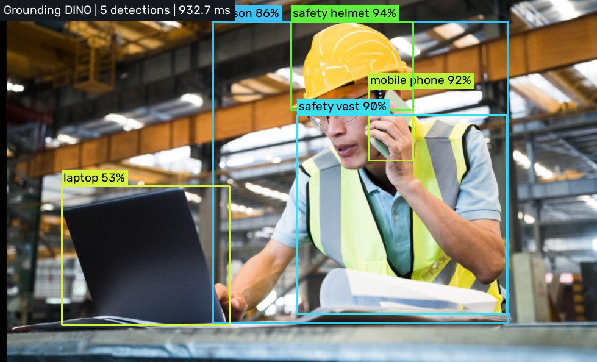
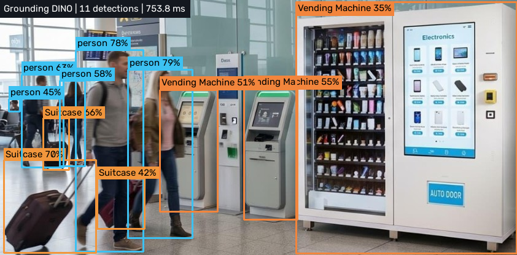
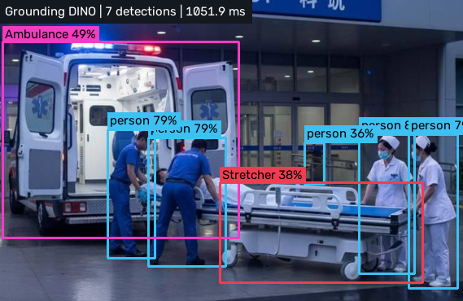
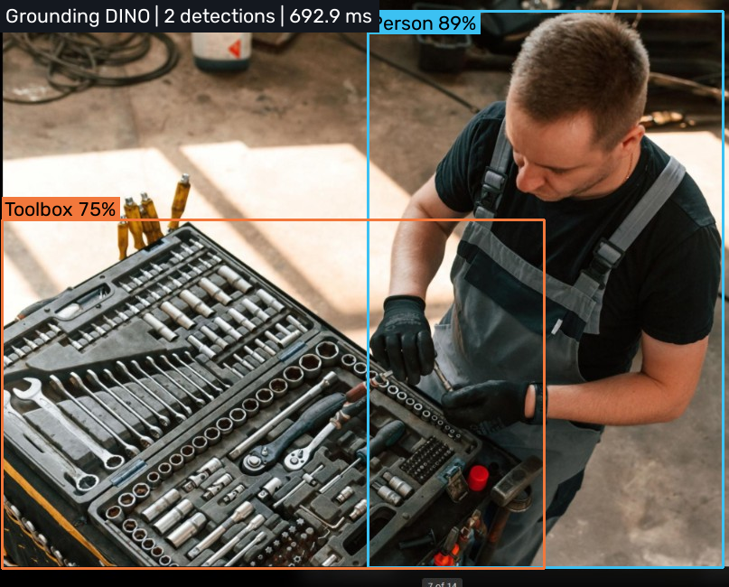
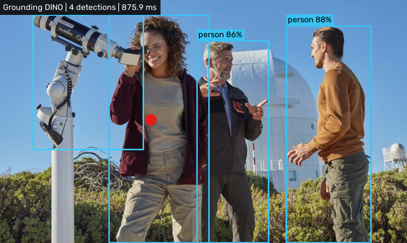
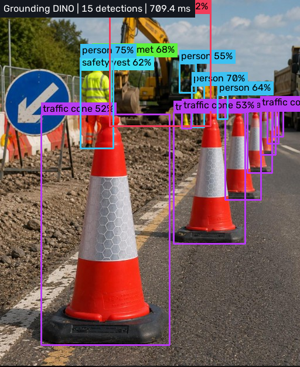

# Open-Vocabulary Object Detection

Find objects in images and videos by **typing their names** (for example `safety helmet` or `stretcher`).
No training is needed. The project compares two ready-made (pretrained) models, **Grounding DINO** and **YOLO-World**,
in a simple web dashboard that runs on your NVIDIA GPU.

What you can do in the dashboard:

- Detect objects in an **image** or a **video**
- Run **both models on the same image** and compare them
- **Download a report** (PDF or HTML) for every test
- Run a **benchmark** (precision, recall, speed) if you have a labelled dataset

---

## 1. The two models

| | Grounding DINO | YOLO-World |
|---|---|---|
| Model used | `IDEA-Research/grounding-dino-tiny` | `yolov8s-worldv2.pt` |
| Library | Hugging Face Transformers | Ultralytics |
| How you give object names | One text line: `person . safety helmet .` | A list: `["person", "safety helmet"]` |
| Speed | Slower | Faster (good for video) |
| Good at | Longer phrases, unusual objects | Speed and real-time style use |
| Download size | about 0.7 GB | about 25 MB + CLIP text model about 340 MB |

**In one sentence:** Grounding DINO reads your text together with the image every time (more flexible, slower), while
YOLO-World converts your names once and then runs like a normal fast YOLO detector.

---

## 2. What you need

- Windows 10/11 with an **NVIDIA GPU** and an up-to-date driver (the command `nvidia-smi` must work)
- **Python 3.11** (3.10 or 3.12 also work). Do **not** use Python 3.13 or 3.14.
- **Git** (needed once to install a small package called CLIP)
- About 4 GB free disk space
- Optional: **ffmpeg** (lets annotated videos play in the browser)

---

## 3. Installation

### Easiest way (two double-clicks)

1. Double-click `setup.bat` (one time only, takes 10-20 minutes)
2. Double-click `run.bat` to start the app

### Step by step (PowerShell)

Open PowerShell inside the project folder and run these lines one by one:

```powershell
# 1) Create a fresh virtual environment with Python 3.11
py -3.11 -m venv .venv

# 2) Activate it (your prompt should now start with (.venv))
./.venv/Scripts/Activate.ps1

# 3) Install everything (this also installs the GPU version of PyTorch)
python -m pip install --upgrade pip
pip install -r requirements.txt

# 4) Check that all is fine and the GPU is found
python check_env.py
```

If PowerShell refuses to activate, run this once and try step 2 again:

```powershell
Set-ExecutionPolicy -Scope Process -ExecutionPolicy Bypass
```

`python check_env.py` should end with **"everything looks good"** and show your GPU name.

---

## 4. Run the app

Every time you want to use the project:

```powershell
cd D:/open_vocabulary_detection
./.venv/Scripts/Activate.ps1
streamlit run app.py
```

Then open **http://localhost:8501** in your browser.
(Or just double-click `run.bat`.)

---

## 5. How to use the dashboard

1. **Image tab** - upload an image, type the objects to find (one per line), press **Run detection**.
2. **Video tab** - upload a video, type the objects, press **Process video**.
3. **Compare models tab** - upload one image, press **Run both models** to see both results side by side.
4. Under any result press **Generate report** and download the **PDF** or **HTML** report. It contains the original image,
   the image with boxes, confidence scores, timing and all settings used.
5. Settings (model, GPU, thresholds, image size) are in the **Control Center** at the top of the page.

The green **"CUDA ready"** label at the top confirms that the GPU is being used.
The app **stops with an error** if no GPU is found. This is on purpose, because the GPU is required.

Command line (optional):

```powershell
python -m detection.image_detection --image photo.jpg --model "Grounding DINO" --prompts "person, safety helmet"
python -m detection.video_detection --video clip.mp4 --model "YOLO-World" --prompts "person, safety vest"
```

---

## 6. Sample results

These are real outputs from the dashboard (Grounding DINO, annotated image view). Each picture shows the boxes,
the object name and the confidence percentage. The title bar at the top of each image shows the number of detections
and the inference time of that run (between about 690 ms and 1050 ms per image in these examples).

Remember: the percentage is the **model's confidence, not accuracy**. The notes below are only visual observations,
not benchmark results.

### 6.1 Workshop with welders
Result: 14 detections, 709.8 ms



Workers, helmets and a safety vest are found. Helmet confidence is lower in this crowded scene (about 36-53%), and
several boxes overlap, so some labels are hard to read.

### 6.2 Worker with phone and laptop
Result: 5 detections, 932.7 ms



A clear, single-person scene: helmet 94%, mobile phone 92%, safety vest 90%, person 86%, laptop 53%.

### 6.3 Airport with vending machine and suitcases
Result: 11 detections, 753.8 ms



People, suitcases and the large vending machine on the right are found. The two self-service kiosks in the middle also
appear to be labelled "Vending Machine" (51% and 55%), which looks like a false positive.

### 6.4 Ambulance and stretcher
Result: 7 detections, 1051.9 ms



The ambulance (49%) and the stretcher (38%) are found, together with the medical staff. This was the slowest example.

### 6.5 Toolbox
Result: 2 detections, 692.9 ms



The open tool case is found as "Toolbox" (75%) and the mechanic as "Person" (89%).

### 6.6 Telescope
Result: 4 detections, 875.9 ms



The telescope on the left and three people are boxed.

### 6.7 Road works with traffic cones
Result: 15 detections, 709.4 ms



Traffic cones (about 52-53%), people, a safety vest and a helmet are found. The row of distant cones produces many
small overlapping boxes, and one label is cut off at the top edge of the image.

---

## 7. The 15 test categories

Person, Safety Helmet, Safety Vest, Fire Extinguisher, Mobile Phone, Laptop, Traffic Cone, Toolbox, Welding Machine,
Industrial Safety Equipment, Vending Machine, Ambulance, Telescope, Stretcher, Suitcase

---

## 8. Measuring accuracy (needs a labelled dataset in COCO format)

Precision, recall and mAP can only be measured if every test image has correct boxes drawn by a person (called
*ground truth*). The app never shows accuracy numbers without it. Helper tools are included:

```powershell
# put your images in dataset/images, then:
python tools/make_coco_skeleton.py --images-dir dataset/images --output dataset/annotations/annotations.json

# draw the boxes in CVAT, Label Studio or Roboflow, export as "COCO 1.0" and replace annotations.json
# (if the tool exports YOLO text files, convert them with tools/yolo_to_coco.py)

# check the file before using it
python tools/validate_coco.py --annotations dataset/annotations/annotations.json --images-dir dataset/images --draw outputs/annotation_check

# run the benchmark for both models
python -m benchmarking.compare_models
```

Results (tables and charts) are saved in `outputs/reports/`.

---

## 9. Challenges we faced

### 9.1 Creating the benchmark dataset (COCO format)
- No ready dataset exists for these 15 categories, so we must **collect images and draw every box by hand**.
- COCO is strict: boxes are `[x, y, width, height]`, category names must match the prompts exactly. One small mistake
  (box outside the image, missing image file, renamed category) silently spoils the results.
- **Industrial Safety Equipment** overlaps with helmet and vest. A fixed rule is needed for what belongs to it.
- Some categories (ambulance, stretcher, vending machine) are harder to photograph, and photos of people need care
  for privacy and image licences.
- If a model is used to pre-draw boxes, the benchmark becomes biased towards that model. Check every box by hand.
- Few images per category means noisy numbers. Aim for about 30 or more images per category.
- *How we help:* the three `tools/` scripts create, convert and validate the COCO file.

### 9.2 Setting up the computer
- **Two Pythons installed (3.11 and 3.14):** Streamlit started from the wrong one and failed with `No module named 'cv2'`.
  Fix: always use the project `.venv` made with `py -3.11`.
- **GPU not used:** the normal Windows PyTorch from PyPI is CPU-only. Fix: `requirements.txt` installs the CUDA build.
- **Version conflicts:** some package versions do not work together (OpenCV, NumPy, huggingface-hub, Transformers, Streamlit).
  Fix: exact versions are pinned in `requirements.txt`.
- **PowerShell:** multi-line `python -c` commands fail. Use `python check_env.py` instead.

### 9.3 Grounding DINO
- **Slower and heavier** than YOLO-World, even on a GPU, so it is less suited to video.
- **Labels can come back partial or merged**, for example two neighbouring prompts joined in one label.
  The project maps each label back to the closest prompt.
- **Results depend on wording.** `welding machine` and `arc welder` can give different results.
- **Two thresholds** (box and text) must be tuned, and they do not mean the same as YOLO-World's confidence.
- **Library changes:** the threshold argument was renamed between Transformers versions. The code checks which name exists.
- **Crowded scenes give overlapping boxes** and some unreadable labels (see samples 6.1 and 6.7).
- **Look-alike objects can be confused**: in sample 6.3 the airport kiosks also appear to be labelled "Vending Machine".
- Large first download (about 0.7 GB).

### 9.4 YOLO-World
- **Names must be loaded with `set_classes()`** every time the prompt list changes. The app does this and checks it worked.
- **Needs the CLIP package and Git.** Ultralytics tries to install it automatically, which needs Git and a restart.
  Fix: CLIP is installed from `requirements.txt`.
- **Extra download:** the CLIP text model (about 340 MB) is fetched on first use.
- **Unusual or ambiguous names are easier to miss**, and it can only return names from the list you give.
- Detection quality depends on the confidence setting: too high misses objects, too low adds false ones.

### 9.5 Comparing the two fairly
- The first run is slower (model start-up), so one warm-up run is done and not timed.
- Each model is benchmarked in a **separate process** so memory numbers are not mixed.
- **Confidence is not accuracy.** A model can be sure and wrong. Only ground truth measures accuracy.
- Testing on one image is only an example. Use the dataset benchmark for real conclusions.
- Reported GPU memory is what PyTorch allocated, not everything the driver reserved.

### 9.6 Video
- Browsers cannot play the default OpenCV video format. Install **ffmpeg** to convert it automatically, or download the file.
- Skipping frames makes processing faster but can miss objects.

---

## 10. Quick fixes

| Problem | What to do |
|---|---|
| "GPU (CUDA) is required" message | `pip uninstall -y torch torchvision`, then `pip install -r requirements.txt`, then `python check_env.py` |
| `No module named 'cv2'` | You are not inside `.venv`. Activate it and run `python check_env.py` |
| Error about `clip` or Git | Install Git for Windows, then run `pip install -r requirements.txt` again |
| First run is very slow | Normal: models are downloading (one time only) |
| Out of GPU memory | Lower "Max long side" or the YOLO size in the Control Center |
| No PDF in the report | `pip install reportlab` (the HTML report always works) |
| Code changes not showing | Stop Streamlit (Ctrl+C) and start it again |

---

## 11. Reference links

- Grounding DINO paper: https://arxiv.org/abs/2303.05499
- Grounding DINO model page: https://huggingface.co/IDEA-Research/grounding-dino-tiny
- Transformers documentation: https://huggingface.co/docs/transformers/model_doc/grounding-dino
- YOLO-World paper: https://arxiv.org/abs/2401.17270
- YOLO-World in Ultralytics: https://docs.ultralytics.com/models/yolo-world/
- COCO annotation format: https://cocodataset.org/#format-data
- Labelling tools: https://www.cvat.ai/ , https://labelstud.io/ , https://roboflow.com/
- Install PyTorch with CUDA: https://pytorch.org/get-started/locally/
- Streamlit documentation: https://docs.streamlit.io/

## Licence note

The project code is MIT. Ultralytics (YOLO-World) is AGPL-3.0, and the model weights have their own licences.
Check them before any commercial use.
